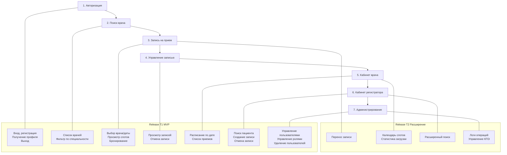

# DOC-REQ-002 User Story Map

| Версия | Статус | Дата обновления |
|---|---|---|
| v1.0 | Draft | 2026-04-01 |

## Backbone (главная ценность)

1. **Авторизация** — вход и управление сессией для всех ролей
2. **Поиск врача** — пациент находит нужного специалиста
3. **Запись на прием** — пациент бронирует свободный слот
4. **Управление записью** — отмена, перенос, просмотр
5. **Кабинет врача** — просмотр расписания и загрузки
6. **Кабинет регистратора** — создание записей, поиск пациентов
7. **Администрирование** — управление пользователями и ролями

## Release T1 (MVP)

| Backbone | Функция | Роль | Приоритет |
|---|---|---|---|
| 1. Авторизация | Регистрация в системе | patient, doctor, registrar, admin | MUST |
| 1. Авторизация | Вход по логину/паролю | All | MUST |
| 1. Авторизация | Получение профиля (me) | All | MUST |
| 1. Авторизация | Выход из системы | All | MUST |
| | | | |
| 2. Поиск врача | Просмотреть список врачей | patient | MUST |
| 2. Поиск врача | Фильтр по специальности | patient | SHOULD |
| | | | |
| 3. Запись на прием | Выбрать врача и дату | patient | MUST |
| 3. Запись на прием | Просмотреть свободные слоты | patient | MUST |
| 3. Запись на прием | Забронировать слот | patient | MUST |
| | | | |
| 4. Управление записью | Просмотреть свои записи | patient | MUST |
| 4. Управление записью | Отменить запись | patient | MUST |
| 4. Управление записью | Перенести запись | patient | COULD |
| | | | |
| 5. Кабинет врача | Просмотреть расписание по дате | doctor | MUST |
| 5. Кабинет врача | Видеть список приемов | doctor | MUST |
| | | | |
| 6. Кабинет регистратора | Найти пациента | registrar | MUST |
| 6. Кабинет регистратора | Создать запись от имени пациента | registrar | MUST |
| 6. Кабинет регистратора | Отменить запись | registrar | MUST |
| | | | |
| 7. Администрирование | Управлять пользователями | admin | MUST |
| 7. Администрирование | Изменять роли пользователей | admin | MUST |
| 7. Администрирование | Удалять пользователей | admin | MUST |

## Release T2 (Расширение)

| Backbone | Функция | Роль | Приоритет |
|---|---|---|---|
| 4. Управление записью | Перенести запись на другой слот | patient | SHOULD |
| 5. Кабинет врача | Просмотреть календарь слотов | doctor | SHOULD |
| 5. Кабинет врача | Видеть статистику загрузки | doctor | COULD |
| 6. Кабинет регистратора | Расширенный поиск пациента | registrar | SHOULD |
| 7. Администрирование | Просмотреть логи операций | admin | SHOULD |
| 7. Администрирование | Задать КПЭ утилизации | admin | COULD |

## Диаграмма User Story Map

