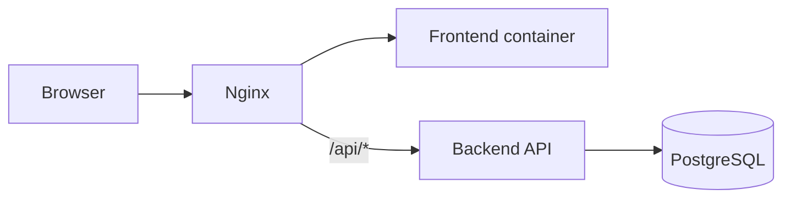

# DOC-ARC-002 Контекст системы и границы решения

| Версия | Статус | Дата обновления |
|---|---|---|
| v1.0 | Draft | 2026-04-01 |

## Компоненты решения

- Frontend SPA (web UI)
- Backend API (Spring Boot)
- PostgreSQL
- Nginx reverse proxy

## Сетевые границы контейнеров

- `nginx` - публичная точка входа (обычно `:80`/`:443`)
- `frontend` - контейнер со статикой SPA (или сборка, отдаваемая `nginx`)
- `backend` - внутренний API-сервис (`/api/v1/**`)
- `postgres` - внутренний сервис БД, недоступный извне напрямую

## Потоки трафика

1. Браузер открывает UI через `nginx`.
2. `nginx` отдает SPA (frontend).
3. API-запросы SPA идут через `nginx` на backend (`/api/v1/**`).
4. Backend работает с PostgreSQL внутри docker-сети.

## Внешние акторы

- Пациент
- Врач
- Регистратор
- Администратор

## Границы MVP

Внутри границ:
- авторизация;
- управление пользователями;
- расписание и слоты;
- записи на прием.

Вне границ:
- интеграции с гос.системами;
- мобильные приложения;
- платежи и страховые расчеты.
