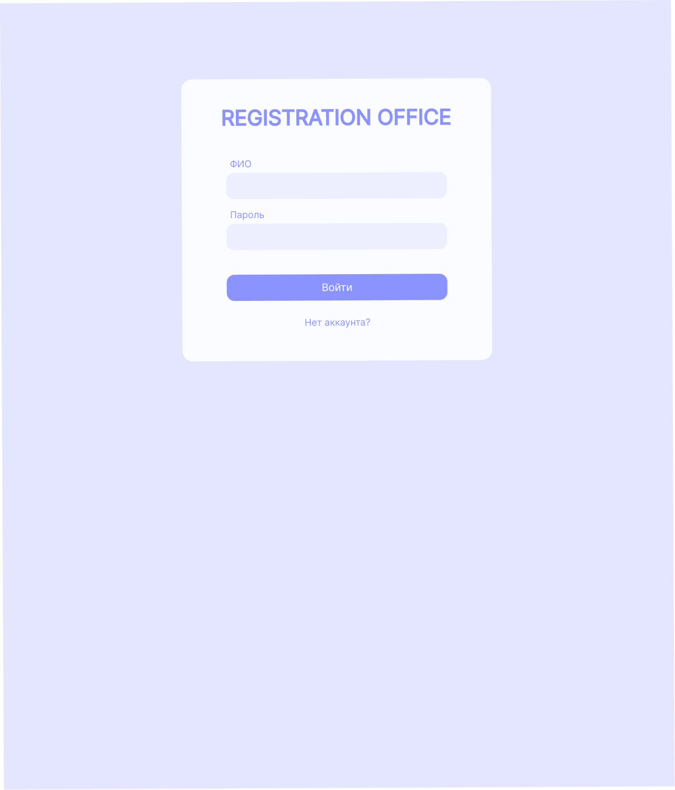
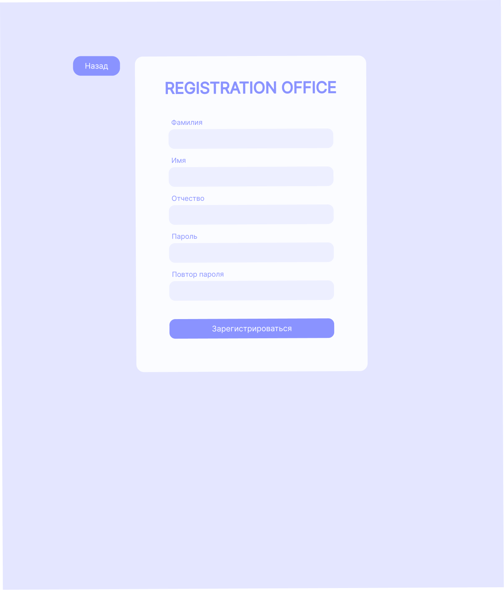
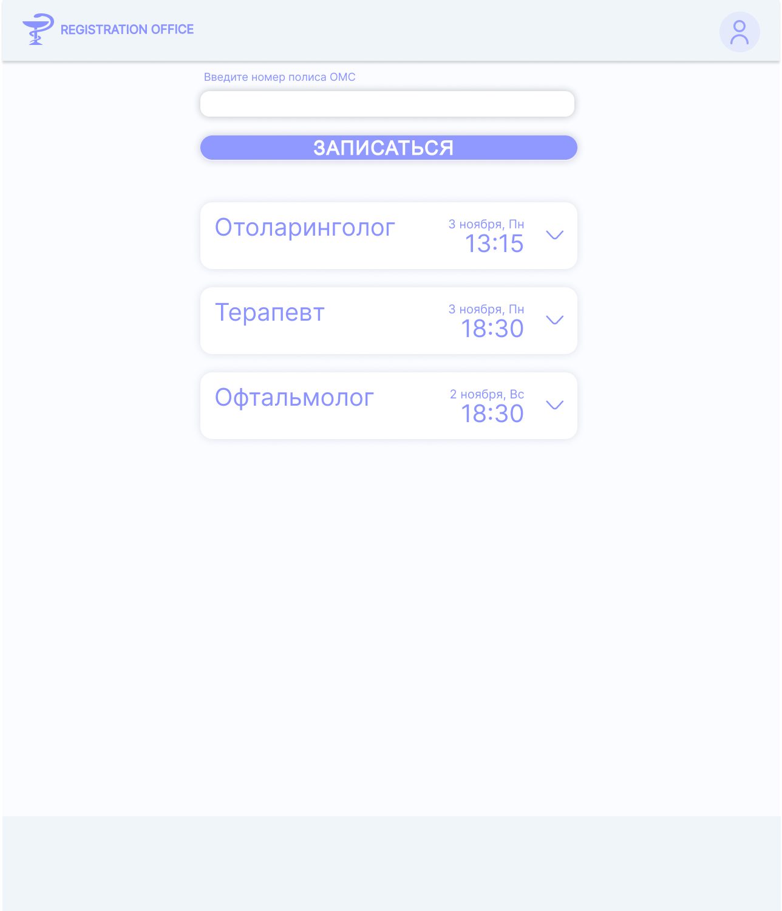
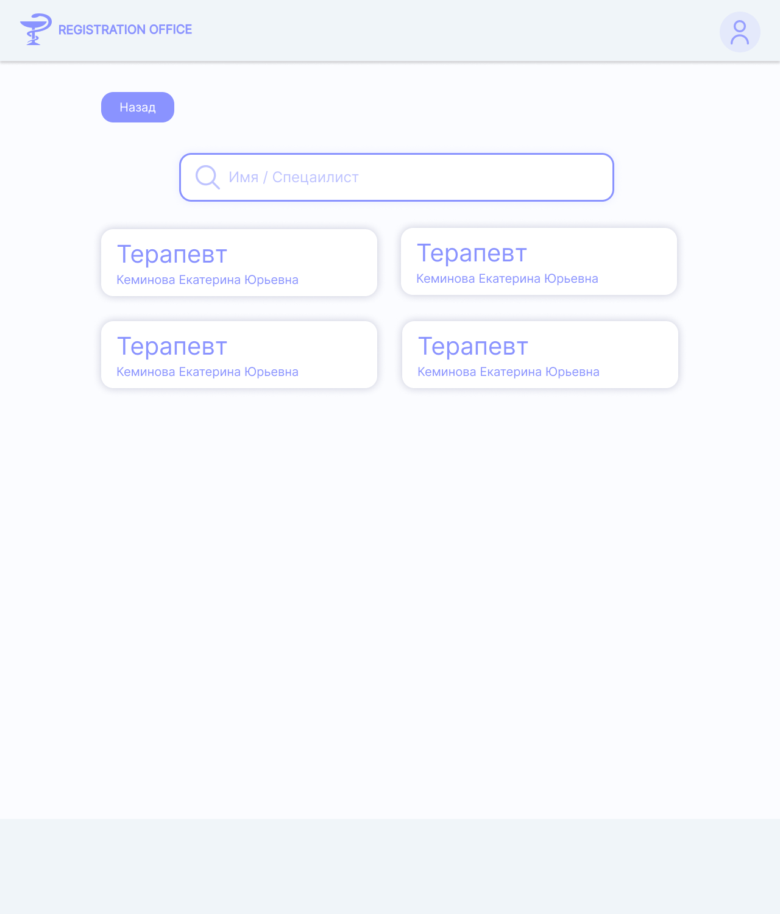
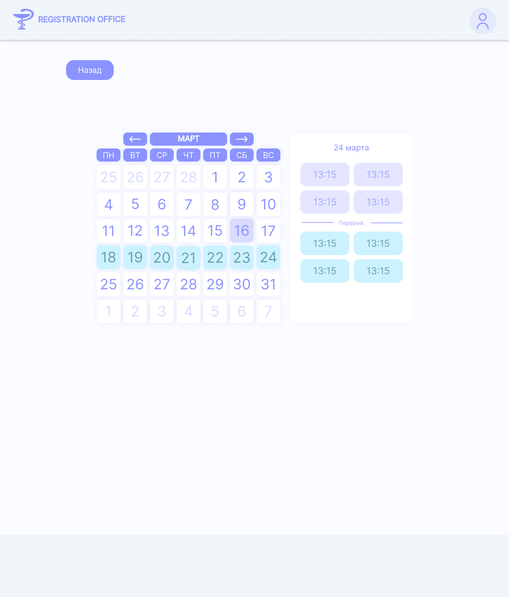
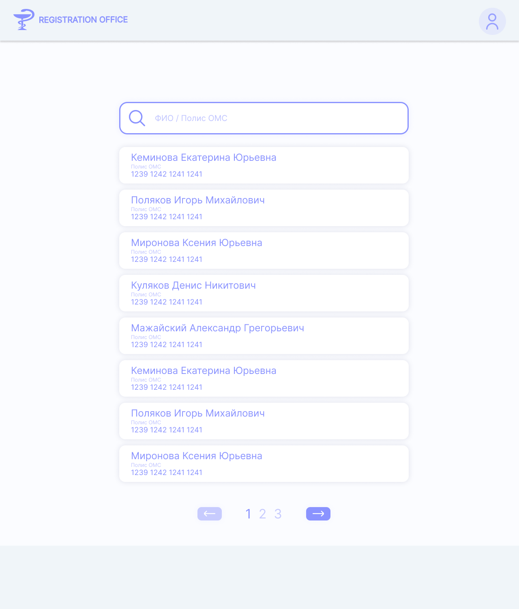
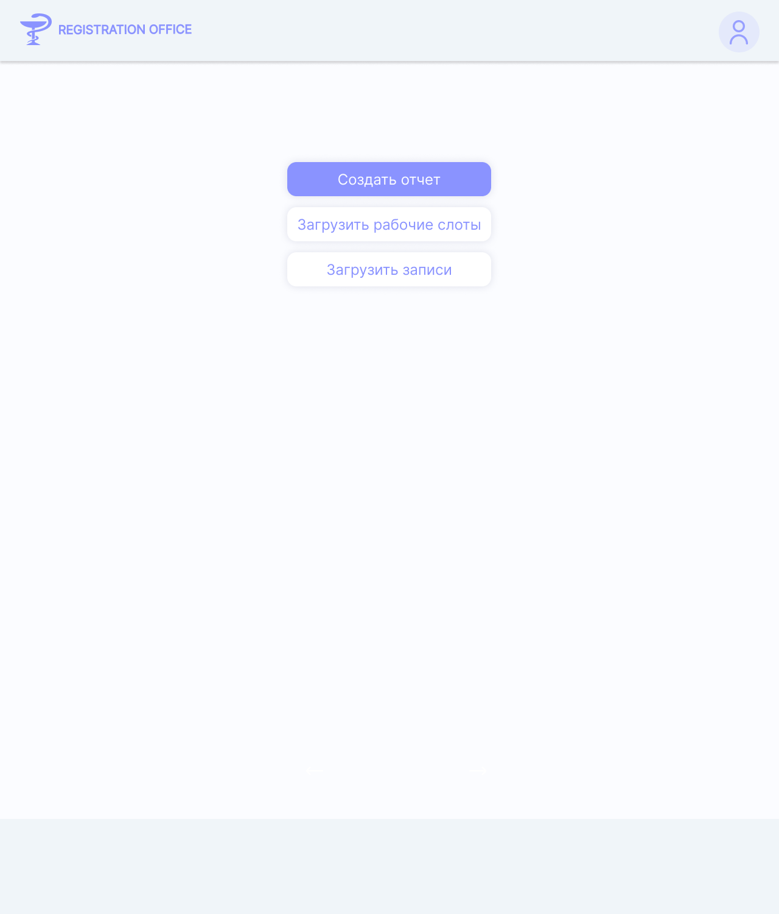

# DOC-ARC-004 Генерация wireframes в Figma

| Версия | Статус | Дата обновления |
|---|---|---|
| v1.0 | Draft | 2026-04-01 |

## Цель

Быстро согласовывать UX-структуру frontend до детальной реализации через низкодетальные макеты.

## Принципы

- wireframes отражают реальную роль и сценарий;
- экраны опираются на текущие backend endpoint'ы;
- каждый wireframe содержит переходы и состояния (loading/error/empty);
- фокус на информационной архитектуре, а не на визуальном дизайне.

## Макеты MVP (T1)

### 1. Авторизация

#### Экран входа

**Элементы:**
- Поле логина
- Поле пароля
- Кнопка "Вход"
- Ссылка "Зарегистрироваться"
- Сообщение об ошибке (если некорректные учетные данные)

#### Экран регистрации

**Элементы:**
- Поле логина
- Поле ФИО
- Поле пароля
- Выбор роли (patient/doctor/registrar/admin)
- Кнопка "Зарегистрироваться"
- Ссылка "Уже есть аккаунт? Войти"

---

### 2. Кабинет пациента (Dashboard)

**Элементы:**
- Приветствие с именем пациента
- Кнопка "Записаться на прием"
- Список текущих записей (будущие приемы)
- История отмененных/завершенных записей
- Кнопка "Найти врача" → переход к поиску
- Личные данные (ФИО, номер полиса)
- Кнопка "Выход"

---

### 3. Поиск врачей и запись

#### Экран поиска врачей

**Элементы:**
- Поле поиска по ФИО врача
- Фильтр по специальности (dropdown)
- Список врачей с пагинацией
- Для каждого врача: ФИО, специальность, кнопка "Записаться"
- Кнопка "Назад" в кабинет

#### Экран календаря и слотов

**Элементы:**
- Дата врача (показанного выше)
- Календарь на месяц или неделя
- Выделены рабочие дни (зеленый) и выходные (серый)
- При выборе дня: список свободных слотов
- Для каждого слота: время, статус (свободен/занят)
- Кнопка "Забронировать" при выборе свободного слота
- Подтверждение с деталями записи

---

### 4. Кабинет врача

#### Расписание по дате

**Элементы:**
- День/дата вверху
- Таблица слотов: время, статус (занят/свободен), ФИО пациента (если занят)
- Для занятого слота: кнопка "Отметить как завершенный" (T1) или "Детали пациента" (T2)
- Навигация по датам (пред/след день)
- Кнопка "Выход"

---

### 5. Кабинет регистратора

**Элементы:**
- Поле поиска пациента (по ФИО или логину)
- Результаты поиска с пагинацией
- Для найденного пациента: ФИО, номер полиса, кнопка "Создать запись"
- При клике: переход на выбор врача/даты/слота (как при записи пациентом)
- Подтверждение создания записи
- История последних созданных записей (опционально)

---

### 6. Администрирование пользователей

**Элементы:**
- Список пользователей с таблицей
- Колонки: ID, ФИО, логин, роль, действия (редактировать, удалить)
- Поле поиска по логину/ФИО
- Кнопка "Добавить пользователя"
- При редактировании: изменение ФИО, роли, специальности (для врачей)
- Подтверждение удаления (софт-удаление)

---

## Состояния и переходы

### Loading-состояния
- При загрузке списка врачей: спиннер или скелетон
- При загрузке слотов: прогресс-бар или спиннер

### Error-состояния
- Ошибка аутентификации: красное сообщение с подсказкой
- Ошибка бронирования (слот уже занят): модальное окно с предложением выбрать другой слот

### Empty-состояния
- Нет записей у пациента: "У вас еще нет записей. Запишитесь на прием"
- Нет свободных слотов: "К сожалению, все слоты заняты. Выберите другую дату"

---

## Принципы навигации

- Верхний navbar со ссылками по ролям
- Хлебные крошки на многоэтапных сценариях (поиск → выбор врача → выбор слота → подтверждение)
- Кнопка "Назад" на каждом экране (кроме главного)
- Кнопка "Выход" в углу (в navbar или меню)

---

## Дальнейшие итерации (T2)

- Расширенный поиск пациентов для регистратора (по номеру полиса, дате рождения)
- Календарь с тепловой картой загрузки врача
- Логи операций в админ-панели
- Уведомления об изменении записей (при наличии backend уведомлений)
