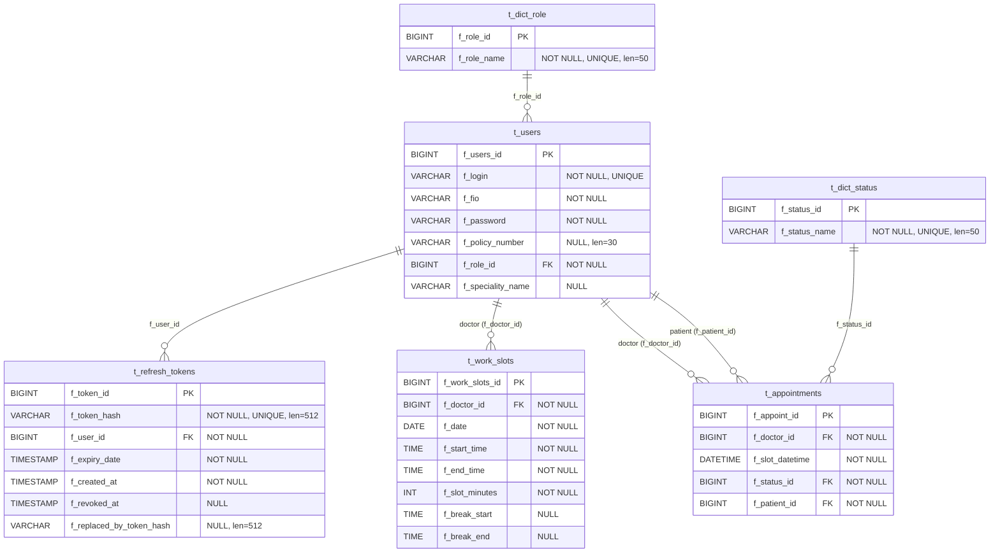

# DOC-DAT-001 Логическая модель данных и ERD

| Версия | Статус | Дата обновления |
|---|---|---|
| v1.0 | Draft | 2026-04-01 |

## Сущности

- `t_users`
- `t_dict_role`
- `t_dict_status`
- `t_work_slots`
- `t_appointments`
- `t_refresh_tokens`

## Ключевые связи

- `t_users.f_role_id -> t_dict_role.f_role_id`
- `t_work_slots.f_doctor_id -> t_users.f_users_id`
- `t_appointments.f_doctor_id -> t_users.f_users_id`
- `t_appointments.f_patient_id -> t_users.f_users_id`
- `t_appointments.f_status_id -> t_dict_status.f_status_id`
- `t_refresh_tokens.f_user_id -> t_users.f_users_id`

## ERD (Mermaid)

## Примечание для frontend

Frontend должен считать `role` и `status` словарными сущностями, а не хардкодить значения в UI.
