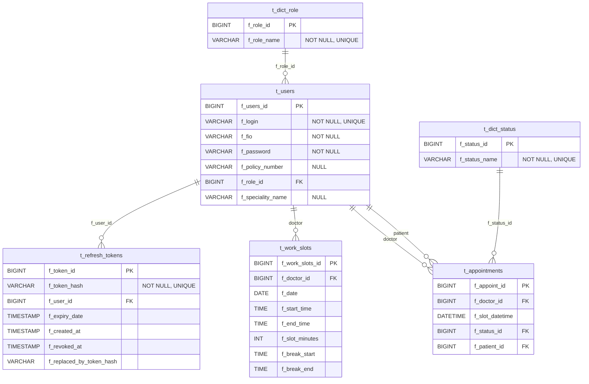

# Документация RegistrationOffice

Эта папка содержит проектную и эксплуатационную документацию для fullstack-проекта `RegistrationOffice` (backend + frontend).

## Быстрая навигация

- Основной обзор проекта: `README.md`
- Технический runbook: `HELP.md`
- Деплой на VM через Docker Compose: `DEPLOY_YC_DOCKER.md`

## Что сейчас есть в `docs/`

- `docs/README.md` — этот файл (карта документации)
- `docs/docs/` — основной комплект проектной документации (GOV/DIS/REQ/PLN/ARC/DAT/INT/SPC/TST/OPS)

## Текущие источники истины в коде

При обновлении документации ориентируйтесь на:

- API-контроллеры: `backend/src/main/java/ru/katacan/registrationoffice/controller`
- Security и доступы: `backend/src/main/java/ru/katacan/registrationoffice/config/SecurityConfig.java`
- Модель данных (JPA сущности): `backend/src/main/java/ru/katacan/registrationoffice/entity`
- Конфигурация приложения: `backend/src/main/resources/application.properties`
- Контейнеризация и прокси: `backend/Dockerfile`, `frontend/Dockerfile`, `frontend/nginx/default.conf`, `docker-compose.yml`, `deploy/nginx/default.conf`

## ERD (Mermaid)

## Правило обновления документации

Любое изменение API, ролей доступа, env-переменных или структуры БД должно сопровождаться обновлением:

1. `README.md`
2. `HELP.md`
3. `DEPLOY_YC_DOCKER.md` (если затронут деплой)
4. `docs/README.md` (если изменена карта документации)
